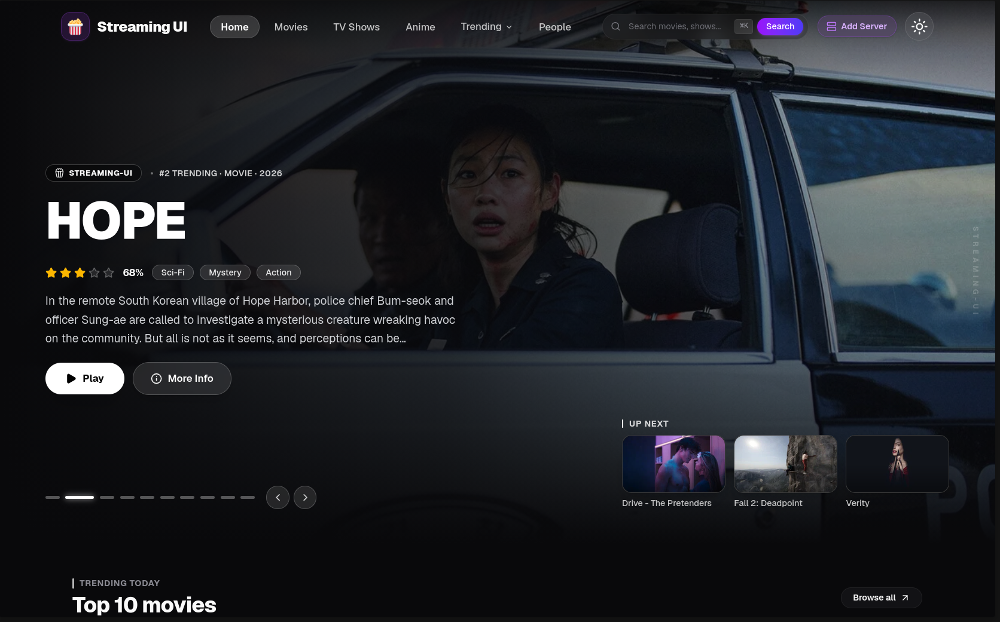
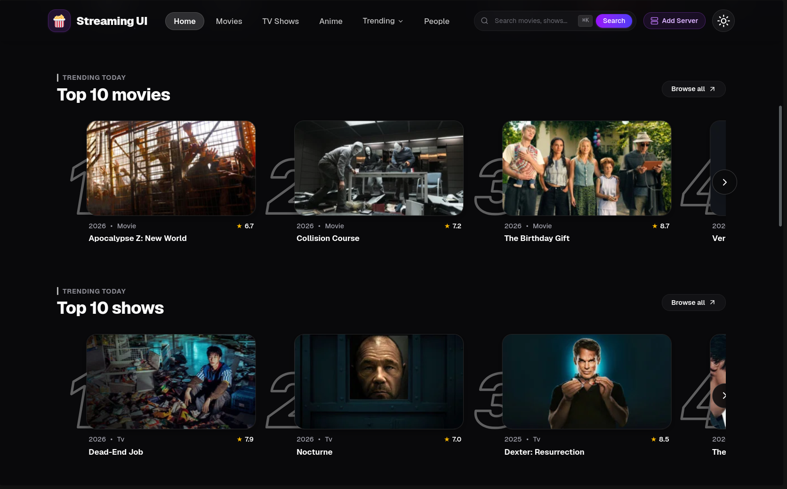
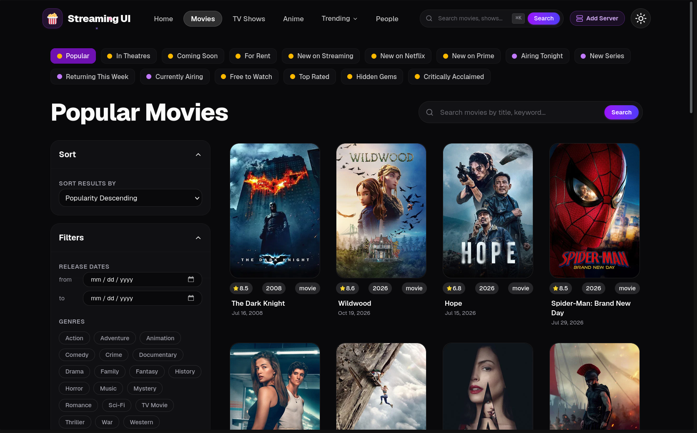
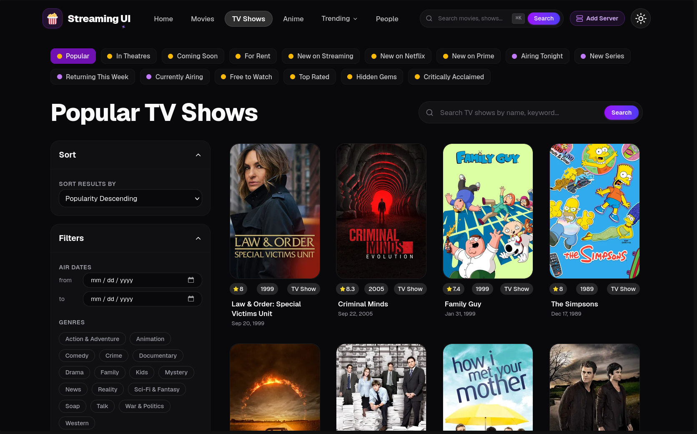
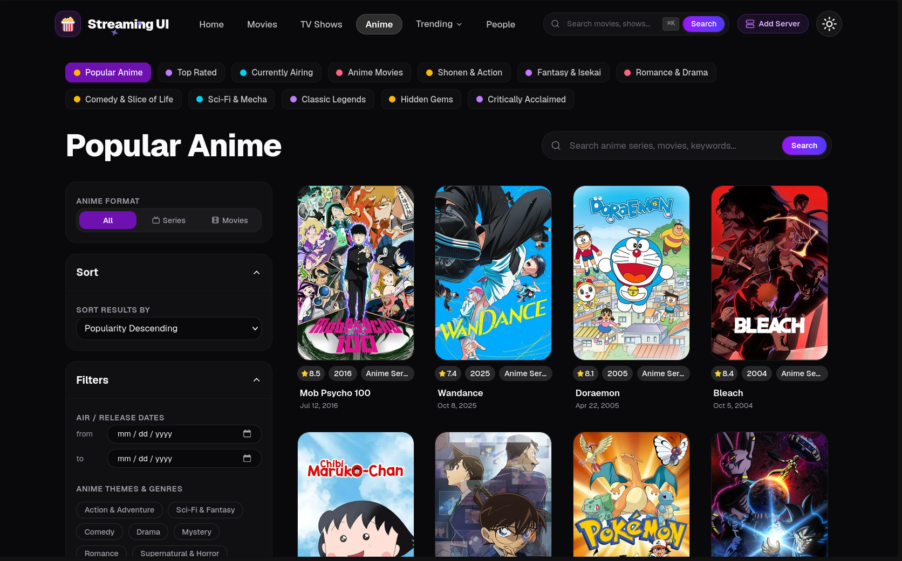
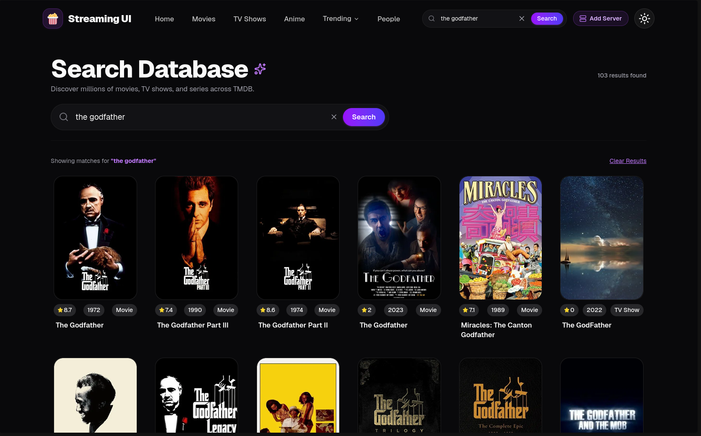
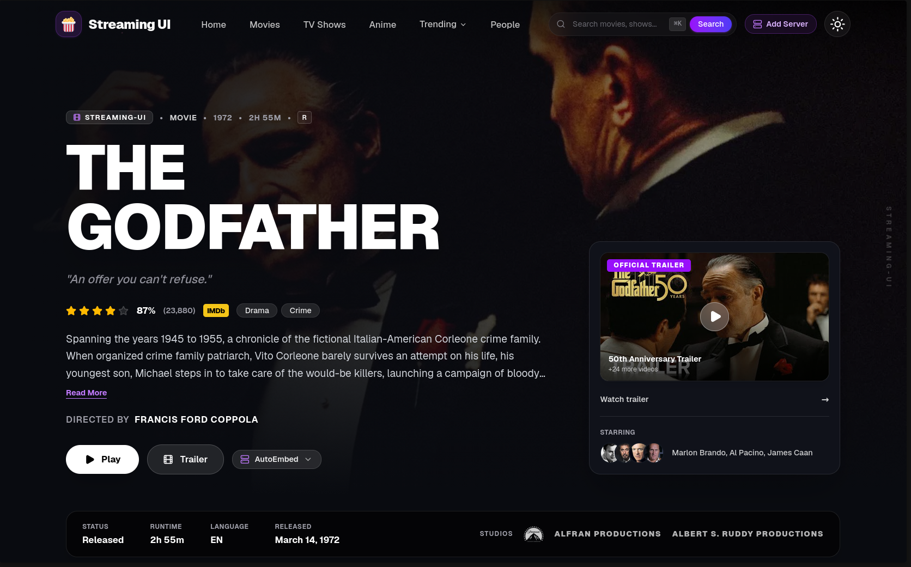
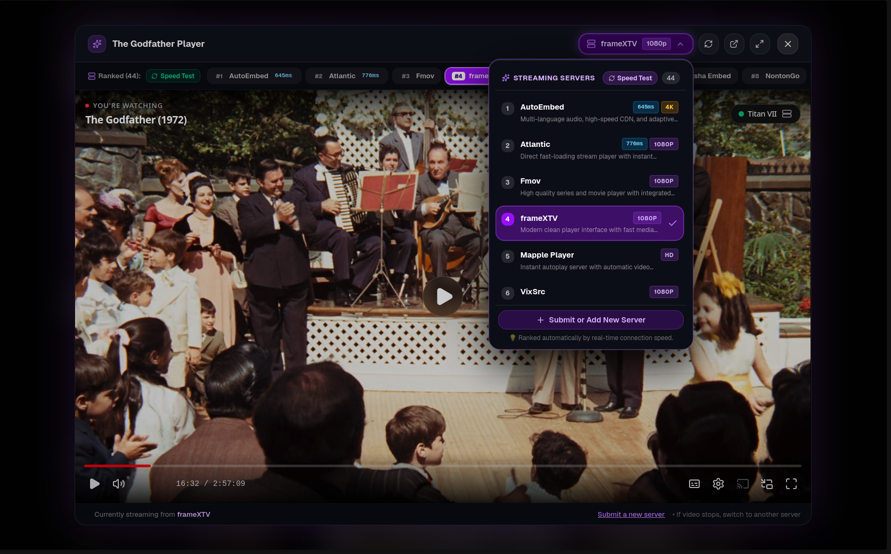

# 🎬 Streaming UI

<div align="center">

[](https://react.dev/)
[](https://www.typescriptlang.org/)
[](https://vite.dev/)
[](https://tailwindcss.com/)
[](https://supabase.com/)
[](LICENSE)

**A next-generation, cinematic streaming web application and media discovery engine.**  
Powered by the TMDB API with **44+ multi-server streaming failovers**, **client-side preflight latency benchmarks**, **dynamic health-ranked server switching**, **interactive trailer previews**, and an **automated daily server discovery bot**.

[Explore Features](#-key-features) • [Visual Showcase](#-visual-showcase--ui-gallery) • [Getting Started](#-getting-started) • [Changelog](https://github.com/Prakul111/Streaming-UI/blob/main/src/components/pages/Changelog.tsx)

</div>

---

## 📸 Visual Showcase & UI Gallery

Experience the visual craftsmanship, responsive layouts, and interactive features of **Streaming UI**:

| CinemaOS Hero & UP NEXT Carousel | Trending Today 3D Perspective Rankings |
| :---: | :---: |
|  |  |
| *Immersive cinematic backdrop with dynamic "UP NEXT" queue* | *Proportional 3D tilt tracking with custom ranked typography* |

| Popular Movies Explorer | TV Series Discovery Hub |
| :---: | :---: |
|  |  |
| *Filter by genres, ratings, sort orders & release periods* | *Comprehensive TV database with season & episode trackers* |

| Dedicated Anime Hub | Instant Multi-Search (⌘K) |
| :---: | :---: |
|  |  |
| *Curated anime catalog with format pills (Series & Films)* | *Debounced concurrent search querying titles, cast & crew* |

| CinemaOS Details & Official Trailer Card | Live Theater Player & Speed Test HUD |
| :---: | :---: |
|  |  |
| *Trailer card integration & floating studio metadata capsule* | *Real-time server latency badges (⚡) and in-player Speed Test* |

---

## 🌟 Key Features

### ⚡ Preflight Server Benchmark & Dynamic Health Ranking
- **Pre-Navigation Latency Probing**: Clicking any movie or TV show card initiates a parallel network latency check across streaming servers with a sleek HUD modal.
- **Dynamic Server Auto-Ordering**: Automatically positions the lowest-latency, highest-performing mirror at **Rank #1** (e.g. `⚡ Optimal < 400ms`).
- **Degraded Server Flagging**: Identifies slow or unavailable servers with red badges and reduced opacity, ensuring uninterrupted streaming.
- **In-Player Speed Test**: Interactive on-demand benchmark button in both the server dropdown and horizontal playback strip to re-evaluate latency live during viewing.

### 🎬 44+ Multi-Server Streaming Engine
- **Instant Server Failover**: Seamlessly toggle between 44+ premium mirrors (AutoEmbed, CineSRC, 2embed, VidSrc, SuperEmbed, Fmov, etc.) with resolution tags (**4K**, **1080p**, **HD**).
- **Embedded Theater Player**: Branded modal with automated next-episode queue advancement, aspect ratio adaptation, fullscreen toggles, and reload safeguards.
- **Upwards-Aware Dropdown**: Intelligent dropdown positioning prevents menu clipping behind hero overlays and controls.

### 🌐 Dual-Mode Server Submissions & Sandbox
- **Save to My Browser**: Instantly store personal streaming mirrors in `localStorage` with zero database lag.
- **Submit to Global Community**: Send new servers to the Supabase PostgreSQL queue for automated health verification and moderation.
- **Live URL Template Parser**: Universal token engine supporting `{tmdbId}`, `{imdbId}`, `{season}`, and `{episode}` with an interactive iframe sandbox preview.

### 🎭 CinemaOS Hero & Media Details
- **Unobstructed Backdrop Architecture**: Top navbar fade mask and bottom-anchored content keep full-bleed backdrop artwork vivid on both mobile and desktop screens.
- **Official Trailer Preview Card**: In-hero trailer video integration for both Movies and TV series with high-resolution YouTube stills.
- **Floating Metadata Capsule**: Translucent glass pill displaying series status, runtime, original audio language, release dates, and authentic studio logos.
- **Triple Episode Browser**: Toggle between snap Carousel Cards, responsive Grid View, and compact Skim List.

### 📋 In-App Interactive Changelog (`/changelog`)
- **Version History & Timeline**: Track releases from `v1.0.0` to `v2.4.0` with categorized tags (**Features**, **Speed & Benchmark**, **Fixes**, **UI/UX**).
- **Search & Filtering**: Search release notes in real time by keyword or filter by change type.
- **Visual Modal Lightbox**: Click any screenshot in the release notes or showcase strip to open an edge-to-edge preview.

### 🤖 Automated Server Discovery Bot
- **Scheduled GitHub Action**: Daily automated health probe (`scripts/server-discovery-bot.js`) running at `04:00 UTC`.
- Tests HTTP availability, `X-Frame-Options` embedding permissions, and network round-trip time.
- Automatically approves verified candidate servers into the production database.

---

## 🛠️ Technology Stack

| Layer | Technologies |
| :--- | :--- |
| **Frontend Framework** | [React 19](https://react.dev/) + [TypeScript 5.7](https://www.typescriptlang.org/) |
| **Build & Tooling** | [Vite 8](https://vite.dev/) (Code-splitting, Lazy Chunks, Fast HMR) |
| **Styling & Design System** | [Tailwind CSS v4](https://tailwindcss.com/) + [daisyUI 5](https://daisyui.com/) |
| **Database & Auth** | [Supabase](https://supabase.com/) (PostgreSQL + PostgREST + Row Level Security) |
| **Data Fetching & Cache** | [TanStack React Query v5](https://tanstack.com/query/latest) (5min fresh / 30min memory cache) |
| **Routing** | [React Router v7](https://reactrouter.com/) |
| **Motion & Carousels** | [Motion (Framer)](https://motion.dev/) + [Embla Carousel](https://www.embla-carousel.com/) |
| **Icons** | [Lucide React](https://lucide.dev/) |
| **CI/CD Automation** | [GitHub Actions](https://github.com/features/actions) |

---

## 📁 Project Structure

```text
├── assets/
│   └── screenshots/              # High-resolution README gallery screenshots
├── public/
│   ├── screenshots/              # Public client screenshots for Changelog lightbox
│   ├── _redirects                # SPA client-side routing fallback rule
│   └── vite.svg
├── scripts/
│   └── server-discovery-bot.js   # Automated health checker & mirror discovery bot
├── src/
│   ├── api/                      # TMDB API hooks (fetch-movie, fetch-tv-shows, fetch-anime, search)
│   ├── components/               # React UI components
│   │   ├── pages/                # Route pages (HomePage, MovieDetails, TvDetails, Changelog, etc.)
│   │   ├── shadcn-studio/        # Navigation menus and design components
│   │   ├── ui/                   # Reusable UI primitives (buttons, modals, search bars)
│   │   ├── navbar.tsx            # Navigation header with debounced search & mobile drawer
│   │   ├── footer.tsx            # Cinematic footer with genre cloud, policies & quick search
│   │   ├── streaming-server-selector.tsx # Ranked server selector dropdown
│   │   ├── submit-server-modal.tsx       # Dual-mode server submission & test sandbox
│   │   └── video-player-modal.tsx        # Theater streaming player modal with Speed Test HUD
│   ├── context/
│   │   └── server-health-context.tsx     # Latency benchmarking provider & server sorting
│   ├── hooks/                    # Custom hooks (useStreamingServers, useDebounce, etc.)
│   ├── lib/                      # Utilities, default servers, and Supabase client
│   ├── App.tsx                   # Route definitions & React Query configuration
│   ├── index.css                 # Global CSS & Tailwind v4 styling
│   └── main.tsx                  # App entry point
├── supabase/
│   └── schema.sql                # PostgreSQL schema, RLS policies, and server seeds
├── package.json
└── tsconfig.json
```

---

## 🚀 Getting Started

### Prerequisites
- [Node.js](https://nodejs.org/) (version 20 or higher)
- [pnpm](https://pnpm.io/) (version 10+) or [npm](https://www.npmjs.com/)

### 1. Clone the Repository
```bash
git clone https://github.com/Prakul111/Streaming-UI.git
cd Reusable-Streaming-UI
```

### 2. Configure Environment Variables
Create a `.env` file in the project root:
```bash
cp .env.example .env
```

Add your credentials:
```env
# TMDB API Read Access Token (Bearer Token)
# Get from: https://www.themoviedb.org/settings/api
VITE_TMDB_API=your_tmdb_read_access_token_here

# Supabase Project URL & Anon Public Key
# Get from: Supabase Dashboard -> Settings -> API
VITE_SUPABASE_URL=https://your-project.supabase.co
VITE_SUPABASE_ANON_KEY=your_supabase_anon_key_here
```

### 3. Install Dependencies
```bash
pnpm install
```

### 4. Start Local Development Server
```bash
pnpm dev
```
Navigate to [http://localhost:5173](http://localhost:5173) in your browser.

---

## 🗄️ Database Setup (Supabase)

To enable global community server submissions and automated health checks:

1. Create a free project at [Supabase](https://supabase.com/).
2. Open the **SQL Editor** in the dashboard.
3. Paste the contents of [`supabase/schema.sql`](supabase/schema.sql) and execute the query.

This configures:
- The `streaming_servers` table with indexing.
- **Row Level Security (RLS)** policies allowing public reads for approved servers and public submissions for pending servers.
- Initial seed streaming mirrors.

---

## 🤖 Running the Health Discovery Bot

Test streaming mirrors locally and probe pending submissions on demand:

```bash
node --env-file=.env scripts/server-discovery-bot.js
```

---

## 🔄 CI/CD & GitHub Actions

The repository includes automated CI/CD pipelines in `.github/workflows/`:
1. **`ci-cd.yml`**: Triggers on pull requests and pushes to `main`. Verifies TypeScript types (`tsc -b`), bundles production assets with Vite, and deploys directly to Vercel.
2. **`server-bot.yml`**: Daily automated cron job running the server discovery probe bot against streaming candidate servers.

### GitHub Repository Secrets
Configure these in **GitHub → Settings → Secrets and variables → Actions**:

| Secret Name | Description |
| :--- | :--- |
| `VITE_TMDB_API` | TMDB API Read Access Token |
| `VITE_SUPABASE_URL` | Supabase Project URL |
| `VITE_SUPABASE_ANON_KEY` | Supabase Anon Public Key |
| `SUPABASE_SERVICE_ROLE_KEY` | Supabase Service Role Key *(for server bot)* |
| `VERCEL_TOKEN` | Vercel Access Token *(for deployment)* |

---

## 📜 Available Scripts

| Command | Action |
| :--- | :--- |
| `pnpm dev` | Starts the Vite local development server with HMR |
| `pnpm build` | Compiles TypeScript (`tsc -b`) and bundles for production with Vite |
| `pnpm preview` | Serves the production bundle locally for testing |
| `pnpm typecheck` | Validates TypeScript types across the codebase |
| `pnpm lint` | Runs ESLint analysis |
| `pnpm format` | Formats code with Prettier and Tailwind CSS class sorting |

---

## 📄 License

This project is open-source and released under the [MIT License](LICENSE).
